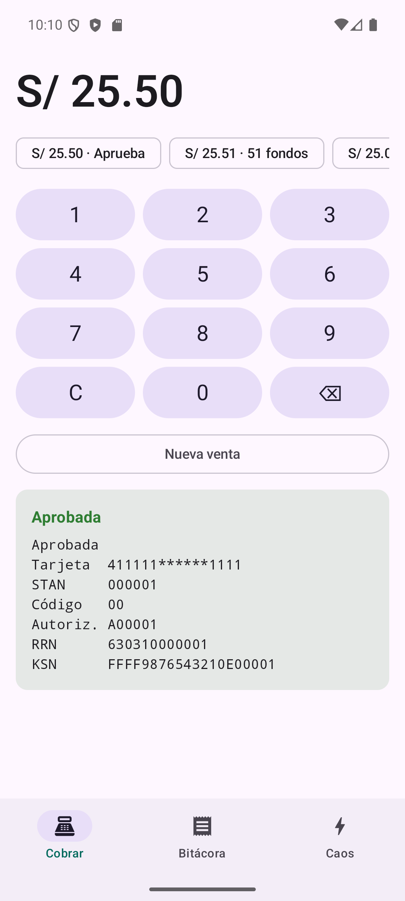
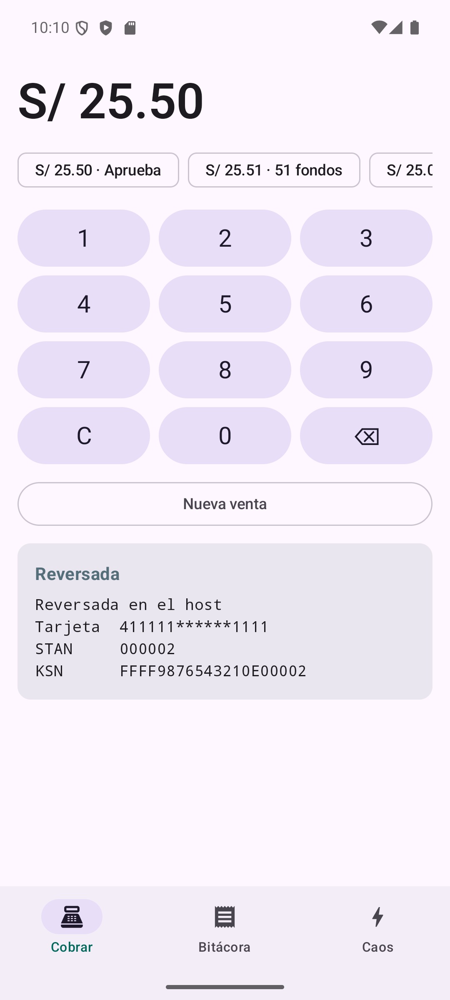
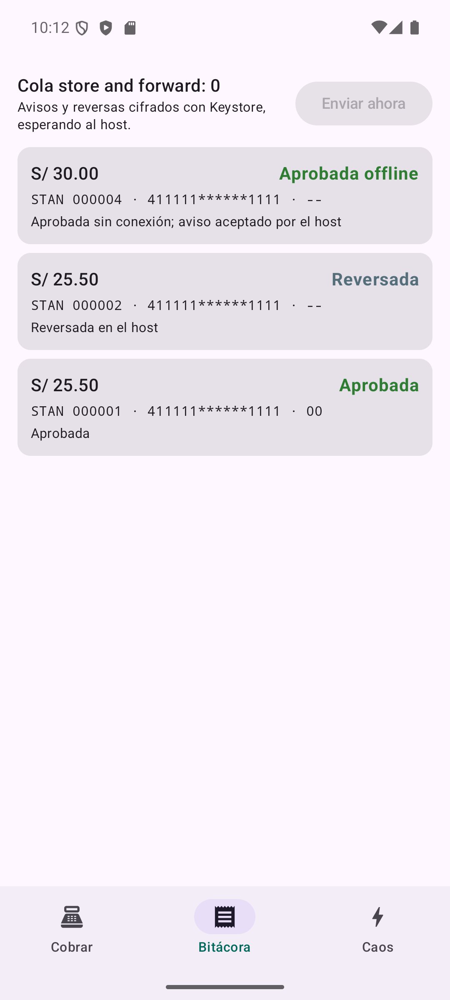

# android-pos

App de caja en **Jetpack Compose**: cobra con el PINpad, autoriza contra
`gateway-mock` por ISO 8583, **reversa** cuando el host no responde y hace
**store and forward** con la cola **cifrada con Android Keystore**. Trae un
**panel de caos** para provocar cada fallo en vivo.

| Aprobada | Timeout → reversa | Bitácora y cola |
| --- | --- | --- |
|  |  |  |

## Cómo correrlo

1. En otra terminal, `gateway-mock`: `./gradlew run`.
2. Opcional, el PINpad por TCP (`pinpad-protocol-kt`): `./gradlew run`. Si no,
   la app usa el simulador interno.
3. Emulador encendido y `./gradlew installDebug`.

```bash
./gradlew testDebugUnitTest   # 14 pruebas del dominio, sin emulador
./gradlew assembleDebug
```

## Qué demostrar en dos minutos

1. **Cobro feliz**: S/ 25.50 → aprobada con código de autorización, RRN y KSN.
2. **El host aprueba y no responde**: en Caos, gateway en
   `TIMEOUT_AFTER_APPROVAL`; cobra S/ 25.50. La app espera 10 s, **no
   reintenta el cobro**, manda la reversa 0400 y muestra "Reversada". En
   `curl localhost:8080/transactions`, la venta está `REVERSED`.
3. **Store and forward**: en Caos, apaga la red del terminal; cobra S/ 30.00
   (bajo el límite de S/ 50.00) → "Aprobada sin conexión" y la cola en 1.
   Prende la red: WorkManager manda el aviso 0220 y la cola baja a 0.
4. **Fallos del PINpad**: NAK, ACK perdido o LRC dañado → el cobro sale igual
   porque el protocolo reintenta; "Cable desconectado" o "Cliente cancela" → el
   cobro falla **sin tocar al host**.

## Arquitectura

```
ui/            Compose + ViewModels (Cobrar, Bitácora, Caos)
domain/        Kotlin puro: lo que se prueba sin Android
  TransactionMachine   transiciones permitidas de un cobro
  ChargeUseCase        PINpad → bitácora → host → reversa/aviso
  Forwarder            vacía la cola en orden, siempre con los mismos bytes
  MessageFactory       arma 0200/0220/0400 y los firma vía PINpad
data/
  pinpad/LinkedPinpad  protocolo de tramas sobre PipeLink (interno) o TCP
  gateway/             ISO 8583 por socket; admin HTTP del gateway
  local/               Room: bitácora y outbox
  security/            AES-256-GCM con llave del Android Keystore
  work/                WorkManager para la cola
di/AppContainer        inyección a mano
```

## Las decisiones que vale la pena defender

- **Un timeout nunca es un rechazo.** `TransactionMachine` no tiene transición
  de "autorizando" a "rechazada" por timeout: solo a "reversando". Y desde ahí
  solo se sale a "reversada" o "reversa pendiente".
- **Qué falló decide qué hacer.** Si no se pudo conectar, no salió nada: se
  aprueba offline bajo el límite o se rechaza. Si se mandó y no hubo respuesta,
  el host pudo haber aprobado: reversa.
- **Write-ahead.** La transacción se guarda en `AUTHORIZING` antes de mandar un
  byte. Si la app muere a mitad del cobro, al volver la reversa.
- **La app nunca tiene llaves.** Arma el mensaje y el PINpad calcula el MAC con
  la variante de MAC de su llave DUKPT. Para reversas y avisos, el PINpad
  avanza el KSN primero: ninguna llave se usa en dos operaciones.
- **Idempotencia por bytes.** La cola guarda el mensaje firmado exacto y lo
  reenvía igual cada vez; el host lo reconoce y no cobra dos veces.
- **PCI en el build.** `pciScan` corre antes de cada compilación y falla si en
  el código aparece un número con forma de PAN (13 a 19 dígitos que pasan Luhn)
  o un log que mencione PAN, pista 2 o PIN.

## Lo que no es real

- El PINpad es un simulador: en un terminal real, la lectura, el PIN y el MAC
  ocurren en el hardware seguro y la app usa el SDK del fabricante.
- ISO 8583 va por TCP sin TLS (en producción, TLS mutuo).
- La pista 2 viaja en claro por el enlace con el PINpad (ver
  `pinpad-protocol-kt`) y se guarda cifrada en la cola para el aviso offline.
- Las respuestas del host no llevan MAC.
